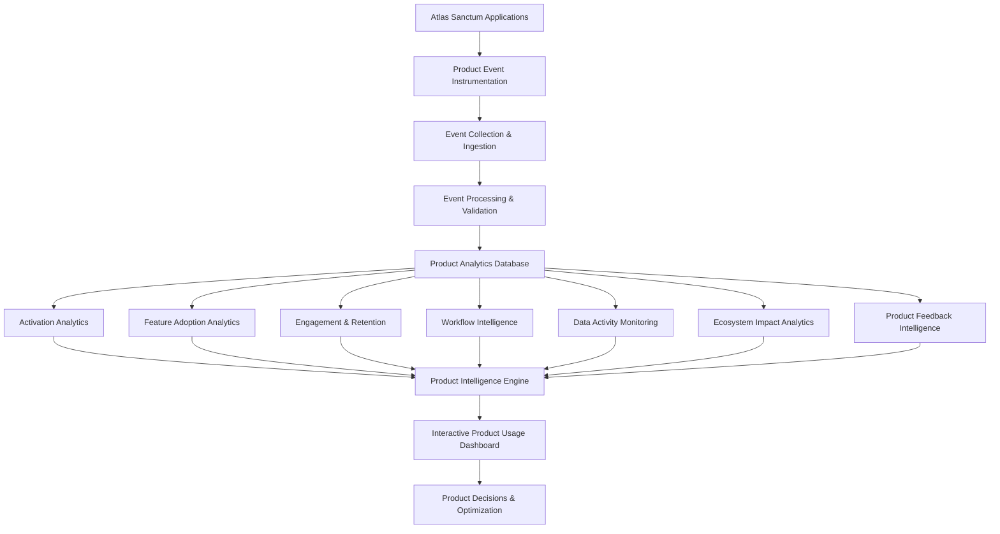
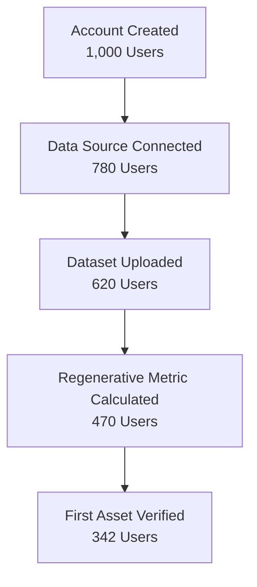
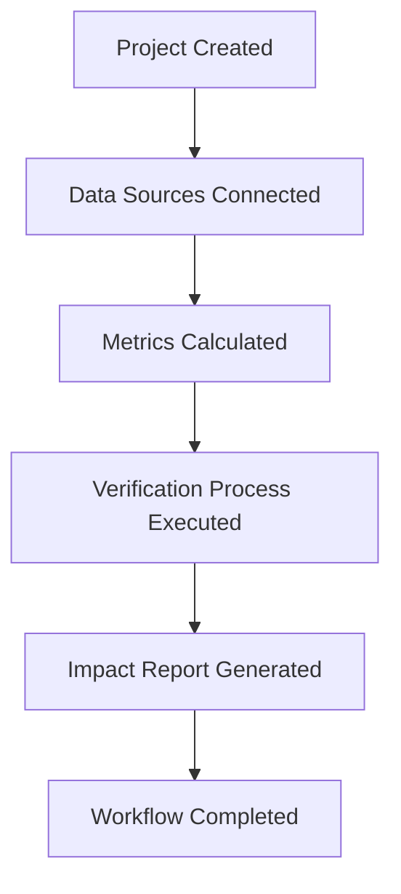
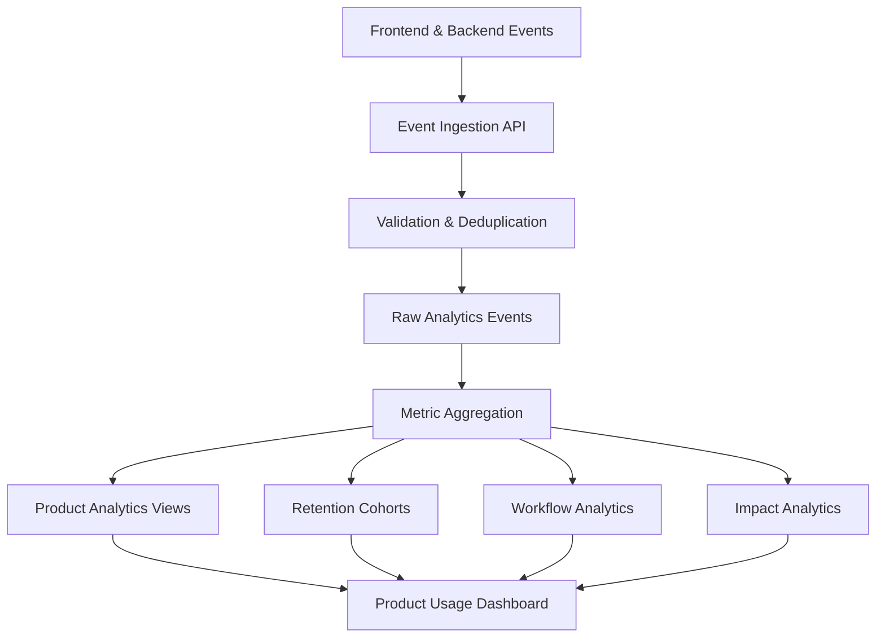

# 📊 Atlas Sanctum | Product Usage Intelligence Dashboard
### Product Telemetry, User Engagement & Ecosystem Intelligence

**Measure Adoption. Understand Behavior. Discover Value.**

The Atlas Sanctum Product Usage Dashboard is an intelligent product analytics and telemetry environment designed to reveal how people interact with the Atlas Sanctum ecosystem, which capabilities generate meaningful engagement, where users encounter friction, and whether platform activity translates into measurable regenerative outcomes.

It moves beyond traditional analytics dashboards that focus primarily on page views, registrations, and login counts.

Instead, it focuses on the fundamental question:

> **Are people actually using Atlas Sanctum in ways that create meaningful, measurable value?**

The dashboard connects user behavior, feature adoption, workflow performance, data activity, customer engagement, and ecological impact into one integrated product intelligence system.

Its purpose is to help product managers, engineers, founders, and operational teams understand the health of the platform and make evidence-based decisions about its evolution.

---

# 🌍 1. The Vision: From Product Analytics to Product Intelligence

Atlas Sanctum is envisioned as a regenerative intelligence platform connecting people, organizations, ecosystems, data, and capital.

As the ecosystem expands, understanding its internal behavior becomes increasingly important.

Traditional analytics answer questions such as:

- How many people visited the platform?
- How many accounts were created?
- How many users logged in?
- How many pages were viewed?

Product intelligence answers deeper questions:

- How many users discovered meaningful platform value?
- Which capabilities are becoming essential to customer workflows?
- Where do users abandon important processes?
- Which features encourage continued engagement?
- Are organizations integrating Atlas into their operations?
- Does platform usage contribute to verified regenerative activity?

The Product Usage Dashboard provides a unified environment for answering these questions.

## Core Design Philosophy

**1. Clarity over complexity**

Product teams should understand platform health within seconds.

**2. Behavior over vanity metrics**

Prioritize meaningful product actions over superficial engagement indicators.

**3. Value over activity**

Differentiate between platform interactions and outcomes that create measurable customer value.

**4. Progressive analytical depth**

Present executive indicators first, then allow users to explore individual behaviors, cohorts, workflows, and underlying events.

**5. Evidence over assumptions**

Clearly distinguish observed product usage, calculated metrics, estimated impacts, and verified real-world outcomes.

---

# 🧠 2. System Architecture

The Product Usage Dashboard operates as a product telemetry and intelligence layer within Atlas Sanctum.

It collects application events, organizes them into analytical datasets, calculates product performance indicators, and delivers interactive visualizations.



## Three Foundational Layers

### Layer 01: Product Instrumentation

Captures meaningful user actions and system events across Atlas Sanctum.

### Layer 02: Product Intelligence

Transforms raw events into activation metrics, feature adoption rates, engagement indicators, retention cohorts, and workflow analytics.

### Layer 03: Product Visualization

Presents the resulting intelligence through interactive dashboards, charts, heatmaps, timelines, and diagnostic panels.

---

# 🚀 3. Activation Intelligence | The Activation Panel

**Discover whether users reach their first moment of meaningful value.**

Activation measures the proportion of new users who complete a predefined set of meaningful actions within a specified period after registration.

For Atlas Sanctum, activation should represent an actual product achievement rather than simply signing in.

## Defining the Atlas Sanctum Aha Moment

Examples of activation events include:

- Connecting a relevant ecosystem data source.
- Uploading the first ecosystem dataset.
- Calculating the first regenerative metric.
- Verifying the first regenerative asset.
- Completing the first policy simulation.
- Generating the first impact report.

The activation definition should be configurable by product, audience, and customer workflow.

## Activation Dashboard Components

### Primary Activation KPI

Display:

- Overall activation rate.
- Weekly activation trend.
- Activation change compared with the previous period.
- Number of newly activated users.
- Median time to activation.

**Example:**

| Metric | Illustrative Value |
|---|---:|
| Activation Rate | 68.4% |
| Previous Period | 61.2% |
| Change | +7.2 percentage points |
| New Activated Users | 342 |
| Median Time to Activation | 2.4 days |

*All dashboard values in this README are illustrative demonstration data.*

### Activation Funnel



Each funnel stage should display:

- Number of users reaching the stage.
- Conversion percentage.
- Drop-off percentage.
- Median completion time.
- Comparison with previous cohorts.

### Engineering Requirements

- Configurable activation definitions.
- Event-based conversion calculations.
- Date-range filtering.
- User-segment filtering.
- Funnel step drill-down.
- Cohort comparison.
- Activation milestone tracking.

**Key insight:** The activation funnel helps teams identify where users encounter friction before discovering the platform's core value.

---

# 🧩 4. Feature Adoption Intelligence

**Understand which capabilities are becoming essential to the ecosystem.**

Atlas Sanctum will contain interconnected products and intelligence services.

Feature Adoption Intelligence measures how effectively users and organizations discover, adopt, and repeatedly use these capabilities.

## Core Feature Clusters

### 01. Impact Verification Engine

Measures engagement with regenerative asset verification and impact evidence.

### 02. Regenerative Asset Exchange

Tracks marketplace exploration, asset submissions, transactions, and verification activity.

### 03. Policy Simulation Engine

Monitors policy modeling, scenario creation, simulation execution, and report generation.

### 04. Data Integration Tools

Measures dataset uploads, external integrations, API usage, and connected data sources.

### 05. Impact Reporting & Visualization

Tracks interactive reports, dashboards, export activity, and impact analysis.

### Feature Adoption Map

Each feature appears as an interactive tile or heatmap component.

A tile communicates:

- Monthly active users.
- Percentage of eligible customers using the feature.
- Adoption growth.
- Usage frequency.
- Repeat engagement.
- Feature activity trend.

### Example Feature Adoption Dataset

| Feature | Active Users | Adoption | Growth |
|---|---:|---:|---:|
| Impact Verification | 284 | 72% | +14% |
| Asset Exchange | 193 | 49% | +8% |
| Policy Simulation | 151 | 38% | +21% |
| Data Integration | 310 | 78% | +18% |
| Impact Reporting | 267 | 67% | +11% |

### Interactive Behavior

Users should be able to:

- Select feature categories.
- Filter by organization.
- Compare feature adoption.
- Inspect adoption trends.
- Explore users who adopted a feature.
- Identify underutilized capabilities.

A feature heatmap should visually communicate adoption intensity while maintaining readable labels and accessible contrast.

**Engineering insight:** Adoption should be calculated against the eligible customer population, not automatically against every registered account. This avoids misleading results when features are available only to certain subscription tiers or roles.

---

# ⚡ 5. Product Engagement Intelligence

**Measure meaningful interactions rather than isolated activity.**

The Product Engagement Score provides an analytical view of how actively users interact with the platform's value-generating capabilities.

Potential behavioral signals include:

- Login frequency.
- Dataset uploads.
- Verification jobs executed.
- Simulations completed.
- Impact reports generated.
- Data integrations maintained.
- Repeated use of core workflows.

## Engagement Score Model

An illustrative model could combine normalized behavioral indicators:

\[
E = \sum_{i=1}^{n} w_i x_i
\]

Where:

- \(E\) = engagement score.
- \(w_i\) = configurable weight assigned to a behavior.
- \(x_i\) = normalized behavior score.
- \(n\) = number of behavioral dimensions.

Possible engagement dimensions:

| Dimension | Illustrative Weight |
|---|---:|
| Meaningful Sessions | 10% |
| Dataset Activity | 20% |
| Verification Activity | 25% |
| Simulation Activity | 20% |
| Reporting Activity | 15% |
| Repeat Workflow Usage | 10% |

Weights should be validated against observed customer behavior and business objectives.

### Engagement Gauge

The dashboard presents an interactive engagement gauge:

| Score Range | Classification |
|---|---|
| 0–24 | Low |
| 25–49 | Emerging |
| 50–74 | Active |
| 75–100 | High |

These thresholds are configurable analytical conventions rather than universal behavioral standards.

### Engagement Intelligence Features

- Engagement trend lines.
- User activity segmentation.
- High-engagement customer identification.
- Declining engagement alerts.
- Feature interaction frequency.
- Repeat usage analysis.
- Account-level engagement comparisons.

Engagement scores should be interpreted as diagnostic indicators, not guaranteed predictions of renewal or customer lifetime value.

---

# 📈 6. Usage Cohort Analysis

**Understand whether product value compounds over time.**

Cohort analysis groups users by a shared starting event, usually the month in which they registered or first activated their accounts.

The dashboard tracks how much of each cohort remains meaningfully active over subsequent periods.

## Retention Matrix

| Cohort | Month 0 | Month 1 | Month 2 | Month 3 | Month 4 |
|---|---:|---:|---:|---:|---:|
| January | 100% | 76% | 68% | 61% | 58% |
| February | 100% | 81% | 72% | 65% | - |
| March | 100% | 79% | 70% | - | - |
| April | 100% | 84% | - | - | - |
| May | 100% | - | - | - | - |

*Illustrative retention data.*

### Cohort Heatmap

The frontend should display each cohort as a row and each period after signup as a column.

Color intensity represents retention.

Healthy cohorts demonstrate sustained engagement, while rapidly fading patterns may indicate onboarding friction, insufficient product value, or changing customer needs.

### Retention Metrics

- User retention.
- Activated-user retention.
- Feature-specific retention.
- Account retention.
- Workflow retention.
- Repeat project engagement.

### Advanced Cohort Analysis

Support cohort segmentation by:

- Acquisition channel.
- Organization type.
- Subscription tier.
- Geographic region.
- User role.
- Activation milestone.
- First adopted feature.

**Important:** Account-level and user-level retention should be analyzed separately. For enterprise platforms, an individual employee may leave while the organization remains an active customer.

---

# 🔄 7. Workflow Completion Intelligence

**Identify friction across complex product journeys.**

Atlas Sanctum enables users to execute multi-stage regenerative workflows.

The Workflow Completion Tracker monitors how effectively users progress through these processes.

## Example: Regenerative Asset Verification



### Workflow Analytics

For each workflow, track:

- Total initiated workflows.
- Successfully completed workflows.
- Completion percentage.
- Abandonment percentage.
- Average completion time.
- Median completion time.
- Stage-specific conversion.
- Failed execution attempts.

### Example Workflow Performance

| Workflow | Initiated | Completed | Completion |
|---|---:|---:|---:|
| Asset Verification | 420 | 294 | 70% |
| Policy Simulation | 310 | 248 | 80% |
| Impact Reporting | 560 | 476 | 85% |
| Data Integration | 230 | 161 | 70% |

### Diagnostic Features

- Workflow funnel visualization.
- Stage duration heatmaps.
- Abandonment analysis.
- Error frequency monitoring.
- Workflow comparison.
- User journey reconstruction.

The system should distinguish user abandonment from technical failures, blocked permissions, and processes that are still running.

This makes workflow analytics actionable rather than merely descriptive.

---

# 📡 8. Data Activity Monitor

**Monitor the operational pulse of the Atlas Sanctum ecosystem.**

Atlas depends on distributed data sources, analytical processes, verification events, and external integrations.

The Data Activity Monitor provides visibility into these operational signals.

## Core Data Indicators

- Datasets uploaded daily.
- Active external integrations.
- Connected APIs.
- Ingestion jobs executed.
- Failed data synchronization attempts.
- Verification jobs running.
- Simulation models executed.
- Data processing latency.

### Data Activity Overview

| Indicator | Example |
|---|---:|
| Datasets Uploaded Today | 428 |
| Active Integrations | 36 |
| Verification Jobs Running | 12 |
| Simulations Executed | 86 |
| Successful Ingestion Jobs | 97.8% |
| Failed Data Jobs | 9 |

### Real-Time Activity Stream

Display chronological operational events:

```text
14:32:08  Ecosystem dataset uploaded
14:31:42  Verification process completed
14:30:19  Policy simulation initiated
14:29:54  External data integration synchronized
14:28:11  Impact report generated
```

*Demonstration events only.*

### Operational Alerts

- Data ingestion interruption.
- Integration authentication failure.
- Abnormally delayed processing.
- Repeated verification failures.
- Simulation execution errors.
- Unexpected reduction in incoming datasets.

**Engineering principle:** A product analytics interface should not pretend that application telemetry is a full observability platform. Operational alerts should be linked to reliable backend monitoring and job-status systems.

---

# 🌱 9. Ecosystem Impact Activity

**Connect digital product usage with real-world regenerative outcomes.**

This is one of the most distinctive dimensions of Atlas Sanctum.

Unlike conventional SaaS dashboards, Atlas must measure not only whether people use the system, but also whether the platform supports meaningful ecological and social activity.

## Impact Indicators

### Land & Biodiversity
- Hectares analyzed.
- Restoration projects registered.
- Habitat monitoring activity.
- Biodiversity assessments completed.

### Climate & Carbon
- Carbon assessment reports generated.
- Estimated sequestration modeled.
- Verified carbon-related outcomes.
- Climate intervention monitoring.

### Water & Ecosystems
- Watersheds analyzed.
- Water quality datasets processed.
- Wetland restoration projects monitored.
- Water-related interventions assessed.

### Regenerative Economy
- Regenerative assets submitted.
- Assets independently verified.
- Transactions recorded.
- Projects financed or supported.

### Example Impact Dashboard

| Indicator | Illustrative Value |
|---|---:|
| Hectares Analyzed | 42,800 |
| Ecosystem Projects Registered | 186 |
| Verified Asset Records | 324 |
| Impact Reports Generated | 1,240 |
| Watersheds Analyzed | 28 |

### Impact Integrity Requirements

Every impact metric should communicate its evidence status:

- **Observed:** Directly measured or recorded.
- **Estimated:** Calculated using a documented methodology.
- **Modeled:** Produced by a simulation.
- **Verified:** Independently validated against defined evidence requirements.

The dashboard must never confuse software activity with ecological outcomes.

For example, generating a carbon sequestration report does not mean carbon has actually been sequestered.

The platform should connect digital events with real-world evidence before classifying outcomes as verified.

---

# 💬 10. Product Feedback Intelligence

**Listen to users and connect their experiences with product behavior.**

The feedback panel aggregates qualitative information from across the Atlas Sanctum ecosystem.

### Feedback Sources

- User feedback submissions.
- Feature requests.
- Support tickets.
- Integration issues.
- Bug reports.
- Customer interviews.
- Product satisfaction surveys.

### Feedback Dashboard

Display:

- Total feedback submissions.
- Open issues.
- Frequently requested capabilities.
- Recurring usability problems.
- Feedback by feature.
- Resolution status.
- Average response time.

### Behavioral Correlation

The dashboard should allow product teams to investigate patterns between feedback and usage.

Example:

A feature demonstrates high registration interest but low adoption.

Users also submit feedback describing a confusing onboarding process.

Atlas surfaces the two signals together, enabling the product team to investigate the relationship.

### Suggested Feedback Categories

| Category | Purpose |
|---|---|
| Usability | Identify interaction and navigation problems. |
| Feature Request | Discover unmet product needs. |
| Performance | Identify speed and reliability concerns. |
| Integration | Understand data connectivity problems. |
| Documentation | Reveal knowledge and onboarding gaps. |

Feedback should be treated as qualitative evidence, not automatically assumed to explain every behavioral pattern.

---

# 🖥️ 11. Product Usage Dashboard Interface

The dashboard should be designed as an interactive product telemetry console.

It should provide a clear hierarchy of product performance, with deeper analytical views available through interaction.

## Main Dashboard Layout

```text
┌──────────────────────────────────────────────────────────────┐
│ ATLAS SANCTUM                         PRODUCT INTELLIGENCE    │
├──────────────────────────────────────────────────────────────┤
│                                                              │
│ PRODUCT USAGE OVERVIEW                                       │
│                                                              │
│  Activation     Engagement      Retention       Active Users │
│    68.4%           76.2            82.1%            1,284    │
│                                                              │
├──────────────────────────────────────────────────────────────┤
│                                                              │
│ ACTIVATION FUNNEL                                            │
│                                                              │
│ Account Created                                              │
│ Data Connected                                               │
│ Dataset Uploaded                                             │
│ Metric Calculated                                             │
│ Asset Verified                                               │
│                                                              │
├──────────────────────────────────────────────────────────────┤
│                                                              │
│ FEATURE ADOPTION MAP                                         │
│                                                              │
│ [Impact Verification] [Asset Exchange] [Policy Simulation]  │
│ [Data Integration]    [Impact Reporting]                     │
│                                                              │
├──────────────────────────────────────────────────────────────┤
│                                                              │
│ PRODUCT ENGAGEMENT       COHORT RETENTION                    │
│ [Engagement Gauge]       [Retention Heatmap]                  │
│                                                              │
├──────────────────────────────────────────────────────────────┤
│                                                              │
│ WORKFLOW COMPLETION       DATA ACTIVITY                      │
│ [Workflow Analytics]      [Live Event Stream]                 │
│                                                              │
├──────────────────────────────────────────────────────────────┤
│                                                              │
│ ECOSYSTEM IMPACT ACTIVITY                                    │
│ [Land] [Carbon] [Water] [Biodiversity]                       │
│                                                              │
├──────────────────────────────────────────────────────────────┤
│                                                              │
│ PRODUCT FEEDBACK & INTELLIGENCE                              │
│                                                              │
│ [Feature Requests] [Usability] [Integration Issues]          │
│                                                              │
└──────────────────────────────────────────────────────────────┘
```

## Design Principles

**Visual Language**
- Futuristic enterprise interface.
- Dark and light themes.
- Glass-inspired dashboard surfaces.
- Subtle gradients and restrained accent colors.
- High-contrast typography.
- Structured information hierarchy.

**Interaction Design**
- Framer Motion transitions.
- Interactive data visualizations.
- Expandable analytical cards.
- Hover and focus states.
- Real-time event updates.
- Context-sensitive drill-down panels.

**Responsive Design**
- Desktop-first analytical workspace.
- Tablet-friendly dashboard grid.
- Mobile-compatible KPI and activity views.

---

# ⚙️ 12. Frontend Engineering Architecture

The application should use a modular architecture separating event analytics, metric calculations, data retrieval, state management, and visual presentation.

## Proposed Technology Stack

| Layer | Technology |
|---|---|
| Frontend | React |
| Language | TypeScript |
| Build Tool | Vite |
| Styling | Tailwind CSS |
| Component System | shadcn/ui |
| Icons | Lucide React |
| Animation | Framer Motion |
| Charts | Recharts |
| Advanced Visualization | D3.js |
| State Management | Zustand |
| Data Fetching | TanStack Query |
| Backend | Supabase |
| Database | PostgreSQL |
| Event Processing | Backend event ingestion services |
| Realtime Updates | Supabase Realtime |
| Authentication | Supabase Auth |
| Deployment | Vercel |

## Suggested Project Structure

```text
src/
│
├── app/
│   ├── App.tsx
│   ├── routes/
│   └── providers/
│
├── components/
│   ├── layout/
│   │   ├── DashboardLayout.tsx
│   │   ├── Sidebar.tsx
│   │   ├── Header.tsx
│   │   └── DashboardNavigation.tsx
│   │
│   └── ui/
│
├── features/
│   └── product-analytics/
│       │
│       ├── components/
│       │   ├── ProductOverview.tsx
│       │   ├── ActivationPanel.tsx
│       │   ├── ActivationFunnel.tsx
│       │   ├── FeatureAdoptionMap.tsx
│       │   ├── EngagementGauge.tsx
│       │   ├── CohortRetention.tsx
│       │   ├── WorkflowTracker.tsx
│       │   ├── DataActivityMonitor.tsx
│       │   ├── EcosystemImpact.tsx
│       │   └── FeedbackPanel.tsx
│       │
│       ├── analytics/
│       │   ├── activation.ts
│       │   ├── adoption.ts
│       │   ├── engagement.ts
│       │   ├── retention.ts
│       │   ├── workflows.ts
│       │   └── impact.ts
│       │
│       ├── hooks/
│       │   ├── useProductMetrics.ts
│       │   ├── useActivation.ts
│       │   ├── useFeatureAdoption.ts
│       │   ├── useCohorts.ts
│       │   └── useActivityStream.ts
│       │
│       ├── services/
│       │   ├── analyticsService.ts
│       │   ├── eventService.ts
│       │   └── feedbackService.ts
│       │
│       ├── stores/
│       │   └── productAnalyticsStore.ts
│       │
│       ├── types/
│       │   └── analytics.ts
│       │
│       └── utils/
│           ├── dateRanges.ts
│           ├── metricCalculations.ts
│           └── cohortCalculations.ts
│
├── lib/
│   ├── supabase.ts
│   └── queryClient.ts
│
└── styles/
    └── globals.css
```

---

# 📡 13. Product Event Instrumentation

A product usage dashboard is only as reliable as its event architecture.

Atlas Sanctum should implement a consistent telemetry convention across all product modules.

## Core Event Categories

| Event | Description |
|---|---|
| account_created | A new user account is registered. |
| session_started | A user begins an application session. |
| datasource_connected | An external data source is connected. |
| dataset_uploaded | An ecosystem dataset is uploaded. |
| metric_calculated | A regenerative metric is calculated. |
| asset_submitted | A regenerative asset is submitted. |
| asset_verified | An asset verification is completed. |
| simulation_executed | A policy simulation is executed. |
| report_generated | An impact report is generated. |
| workflow_completed | A defined workflow is completed. |
| feedback_submitted | A user submits product feedback. |

## Standard Event Schema

```typescript
export interface ProductEvent {
  id: string;

  eventName: string;

  userId?: string;
  organizationId?: string;
  anonymousId?: string;

  sessionId?: string;

  feature: string;

  properties: Record<
    string,
    string | number | boolean | null
  >;

  timestamp: string;

  environment: "development" | "staging" | "production";

  schemaVersion: number;
}
```

### Example Event

```typescript
const event: ProductEvent = {
  id: crypto.randomUUID(),

  eventName: "asset_verified",

  userId: "user_123",
  organizationId: "org_456",

  sessionId: "session_789",

  feature: "impact_verification",

  properties: {
    assetType: "reforestation",
    verificationStatus: "completed",
    processingDurationSeconds: 42
  },

  timestamp: new Date().toISOString(),

  environment: "production",

  schemaVersion: 1
};
```

### Instrumentation Requirements

- Consistent event naming.
- Versioned event schemas.
- Duplicate event protection.
- Organization and user attribution.
- Server-side validation of consequential events.
- Timestamp consistency.
- Event delivery monitoring.
- Privacy-aware property collection.

A browser event should not be treated as proof that a backend operation succeeded. For important actions such as asset verification, the authoritative event should originate from the backend operation or its verified completion record.

---

# 🗄️ 14. Data Architecture

The analytics layer should distinguish between raw telemetry, processed product metrics, and verified impact records.

## Proposed Database Entities

| Entity | Purpose |
|---|---|
| analytics_events | Stores normalized product events. |
| user_profiles | Stores authorized user metadata. |
| organizations | Represents customer organizations. |
| feature_catalog | Defines measurable product features. |
| activation_events | Tracks activation milestones. |
| workflow_runs | Stores workflow execution records. |
| workflow_steps | Tracks individual workflow stages. |
| integration_status | Monitors external data integrations. |
| impact_records | Stores evidence-backed impact measurements. |
| feedback_records | Stores user feedback and requests. |

### Analytical Data Flow



### Performance Considerations

- Use database indexes for event timestamps, organization IDs, and event names.
- Precompute expensive analytical aggregations.
- Use paginated event streams.
- Apply appropriate retention policies to raw telemetry.
- Separate operational tables from analytical queries where necessary.
- Use server-side aggregation for large datasets.
- Avoid querying entire event histories directly from the browser.

---

# 🔐 15. Privacy, Security & Data Governance

Product telemetry must be useful without becoming unnecessarily invasive.

## Security Requirements

- Authenticated dashboard access.
- Role-based permissions.
- Organization-level data isolation.
- Database Row Level Security.
- Secure server-side event ingestion.
- Restricted access to user-level behavioral data.
- Protection of sensitive customer information.
- Configurable analytics data retention.

## Privacy Principles

- Collect only events necessary for defined analytical purposes.
- Avoid collecting sensitive personal information in event properties.
- Apply aggregation when individual-level detail is unnecessary.
- Respect consent and applicable privacy requirements.
- Document event collection and processing policies.
- Provide controlled access to customer analytics.

Product managers should generally see aggregated adoption and retention patterns, while access to individual user activity should be restricted to legitimate operational purposes.

---

# 🧪 16. Metric Definitions & Calculation Logic

Consistent definitions ensure that the dashboard does not present misleading numbers.

### Activation Rate

\[
Activation\ Rate =
\frac{Activated\ New\ Users}
{Eligible\ New\ Users}
\times 100
\]

An activated user is one who completes the defined activation milestone within the specified measurement window.

### Feature Adoption Rate

\[
Adoption\ Rate =
\frac{Eligible\ Active\ Users\ Using\ Feature}
{Eligible\ Active\ Users}
\times 100
\]

### Workflow Completion Rate

\[
Completion\ Rate =
\frac{Successfully\ Completed\ Workflows}
{Eligible\ Initiated\ Workflows}
\times 100
\]

### User Retention Rate

\[
Retention =
\frac{Returning\ Eligible\ Users}
{Original\ Cohort\ Users}
\times 100
\]

The precise definition of returning activity must remain consistent across measurement periods.

### Time to Value

\[
TTV = T_{FirstValueEvent} - T_{Signup}
\]

The first-value event should be explicitly defined for each customer segment.

### Metric Governance

Every metric should document:

- Name and definition.
- Numerator and denominator.
- Measurement window.
- Eligible population.
- Data source.
- Update frequency.
- Known limitations.

---

# 🛣️ 17. Development Roadmap

## Phase 1: Product Analytics Foundation

- [ ] Create dashboard layout.
- [ ] Implement KPI cards.
- [ ] Establish product event schema.
- [ ] Create demo analytics datasets.
- [ ] Build activation metrics.
- [ ] Implement activation funnel.
- [ ] Add global date filters.

## Phase 2: Adoption & Engagement Intelligence

- [ ] Build feature adoption heatmap.
- [ ] Implement engagement calculations.
- [ ] Build engagement gauge.
- [ ] Add feature comparison views.
- [ ] Implement user segmentation.
- [ ] Add adoption trends.

## Phase 3: Retention & Workflow Analytics

- [ ] Build cohort retention heatmap.
- [ ] Implement activation-based retention.
- [ ] Build workflow completion tracker.
- [ ] Add workflow duration analytics.
- [ ] Implement abandonment diagnostics.
- [ ] Add customer-level drill-down views.

## Phase 4: Operational & Data Intelligence

- [ ] Implement event ingestion.
- [ ] Build data activity monitor.
- [ ] Add integration health indicators.
- [ ] Integrate real-time event streams.
- [ ] Add operational alert handling.
- [ ] Implement analytical aggregation services.

## Phase 5: Regenerative Impact Intelligence

- [ ] Integrate ecosystem impact records.
- [ ] Build land and biodiversity indicators.
- [ ] Add climate and water metrics.
- [ ] Distinguish estimated and verified outcomes.
- [ ] Connect regenerative asset activity.
- [ ] Build evidence-backed impact reporting.

## Phase 6: Feedback & Product Optimization

- [ ] Integrate feedback records.
- [ ] Build product feedback intelligence.
- [ ] Add feature-specific feedback filters.
- [ ] Implement behavioral correlation views.
- [ ] Add product improvement tracking.
- [ ] Develop product health reporting.

---

# 📈 18. Product Success Criteria

The dashboard should measure more than its own technical performance.

It should enable the Atlas Sanctum team to understand whether the platform is becoming more valuable to its users.

| Dimension | Success Indicator |
|---|---|
| Activation | More eligible users reach meaningful value. |
| Adoption | Core capabilities gain sustained usage. |
| Engagement | Meaningful product interactions increase. |
| Retention | Customers continue using the platform over time. |
| Workflow Efficiency | More workflows complete successfully. |
| Reliability | Data integrations and processing remain healthy. |
| Impact | More outcomes are supported by credible evidence. |
| Feedback | Recurring product friction is identified and addressed. |

### Product Intelligence Questions

The completed dashboard should enable the team to answer:

1. Are users discovering the platform's core value?
2. Which capabilities generate sustained engagement?
3. At what point do users abandon important workflows?
4. Which customer cohorts retain meaningful activity?
5. Are organizations integrating Atlas into their operations?
6. Are data pipelines functioning reliably?
7. Is platform activity translating into documented regenerative outcomes?
8. What should the product team improve next?

---

# 🤝 19. Contributing

Atlas Sanctum welcomes contributions from:

- Frontend engineers.
- Full-stack developers.
- Product analysts.
- Data engineers.
- AI and machine learning researchers.
- UX/UI designers.
- Ecological data scientists.
- Product managers.

### Contribution Opportunities

- Product analytics instrumentation.
- Dashboard architecture.
- Event processing.
- Retention and cohort calculations.
- Interactive visualization.
- Data pipeline engineering.
- Product experimentation.
- Regenerative impact measurement.

### Development Workflow

1. Fork the repository.
2. Create a feature branch.
3. Implement and test your changes.
4. Document metric definitions and event requirements.
5. Submit a pull request.

---

# 📜 20. License

Add the appropriate open-source license once the project's licensing and contribution terms have been established.

---

# ✨ The Larger Vision: From Application to Infrastructure

The Product Usage Dashboard represents an essential layer in Atlas Sanctum's evolution.

A product is not successful simply because it attracts registrations, generates activity, or looks impressive.

It becomes valuable when people repeatedly rely on it to accomplish meaningful things.

Users connect data.

Organizations verify regenerative assets.

Researchers run policy simulations.

Institutions generate impact reports.

Communities gain visibility into environmental and social outcomes.

These actions create a cycle of discovery, adoption, engagement, and measurable value.

The Product Usage Dashboard makes that cycle visible.

**It reveals whether Atlas Sanctum is becoming part of the operational fabric of regenerative activity.**

The long-term ambition is not merely to build another analytics dashboard.

It is to develop the product intelligence infrastructure needed to understand, improve, and scale an interconnected regenerative technology ecosystem.

---

**ATLAS SANCTUM**

*Intelligence in Service of Life.*

**Measure Usage. Discover Value. Scale Regeneration.**
